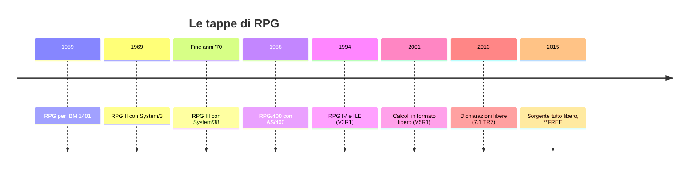

RPG significa **Report Program Generator**: nasce alla fine degli anni Cinquanta per produrre
stampe a partire dalle schede perforate. Da allora è cambiato moltissimo, ma i programmi
scritti nelle sue versioni precedenti girano ancora, e chi lavora con RPG li incontra ogni
giorno. Per questo conviene conoscerne la storia.

## Sessant'anni in una riga

<Diagram alt="Linea del tempo di RPG: 1959 RPG per IBM 1401; 1969 RPG II con System/3; fine anni Settanta RPG III con System/38; 1988 RPG/400 con AS/400; 1994 RPG IV e ILE con OS/400 V3R1; 2001 calcoli in formato libero con V5R1; 2013 dichiarazioni in formato libero con IBM i 7.1 TR7; 2015 sorgente interamente libero con **FREE" caption="Le tappe principali di RPG">

</Diagram>

- **RPG e RPG II.** Il programmatore descrive i file, i campi e le righe della stampa, e il
  compilatore genera il programma che legge i record uno alla volta e stampa i totali. Il
  flusso del programma è implicito: è il **ciclo RPG**, che vedrai nell'ultimo modulo.
- **RPG III e RPG/400.** Con System/38 e poi AS/400 arrivano il database integrato, i video
  interattivi e le istruzioni strutturate come `IF` e `DO`. Il sorgente resta a colonne
  fisse, con nomi di al massimo sei caratteri.
- **RPG IV**, chiamato anche **ILE RPG**, arriva nel 1994 con l'Integrated Language
  Environment: nomi più lunghi, le specifiche D per le dichiarazioni, le espressioni con
  `EVAL`, le funzioni incorporate come `%trim` e i **moduli** che si collegano tra loro. Due
  anni dopo arrivano le **procedure** scritte in RPG, la base dei programmi di servizio. I
  sorgenti RPG IV hanno il tipo `RPGLE`.
- **Il formato libero** arriva un pezzo alla volta: prima i calcoli tra `/FREE` e
  `/END-FREE`, poi le dichiarazioni e infine, nel 2015, il sorgente interamente libero che
  inizia con `**FREE`.

L'hardware nel frattempo ha cambiato nome più volte: AS/400, iSeries, System i. Il sistema
operativo, nato come OS/400, oggi si chiama **IBM i** e gira sui server IBM Power. Un
programma compilato su un AS/400 degli anni Novanta, in genere, gira ancora oggi senza
essere ricompilato.

## Lo stesso calcolo, due formati

Questo è un pezzo di RPG IV **a colonne fisse**. Ogni informazione ha il suo posto: la
lettera in colonna 6 dice il tipo di specifica (`D` per le dichiarazioni, `C` per i calcoli),
il codice operativo comincia in colonna 26 e così via.

```text title="Formato fisso"
     D TOTALE          S             11P 2
     D IMPORTO         S              9P 2
     C                   IF        IMPORTO > 0
     C                   EVAL      TOTALE = TOTALE + IMPORTO
     C                   ENDIF
```

Lo stesso codice **in formato libero**. Ogni istruzione finisce con il punto e virgola,
l'indentazione è libera e le dichiarazioni dicono il tipo a parole:

```text title="Formato libero"
**FREE
dcl-s totale packed(11:2);
dcl-s importo packed(9:2);

if importo > 0;
  totale += importo;
endif;
```

<Callout type="note" title="Che cosa scriverai in questo corso">
  Tutto il codice nuovo del corso è in formato libero con `**FREE`, come si scrive oggi. Il
  formato fisso compare solo nell'ultimo modulo, dove impari a leggerlo e a tradurlo.
</Callout>

## Perché RPG è ancora qui

RPG non è sopravvissuto per inerzia. Ha alcune caratteristiche che i gestionali apprezzano:

- **è vicino al database**: dichiari un file e i suoi campi diventano variabili del programma,
  senza mappature;
- **conta i decimali come un ragioniere**: i numeri decimali a virgola fissa (`packed`,
  `zoned`) non hanno gli errori di arrotondamento dei numeri in virgola mobile;
- **è compatibile all'indietro**: i programmi scritti decenni fa convivono con quelli nuovi,
  anche nello stesso sorgente.

## Verifica

<Quiz id="quiz-storia-di-rpg" title="La storia di RPG" attempts={3}>
  <Question id="significato-rpg" type="single" explanation="RPG nasce per generare stampe a partire dai dati dei file: da qui il nome.">
    Che cosa significa la sigla RPG?

    <Option correct>Report Program Generator</Option>
    <Option explanation="Il gioco di ruolo non c'entra.">Role Playing Game</Option>
    <Option>Rapid Program Generator</Option>
  </Question>

  <Question id="ordine-versioni" type="order" explanation="RPG II arriva con System/3, RPG III con System/38, RPG/400 con AS/400 e RPG IV con ILE nel 1994.">
    Metti in ordine le versioni di RPG, dalla più vecchia alla più recente.

    <Option>RPG II</Option>
    <Option>RPG III</Option>
    <Option>RPG/400</Option>
    <Option>RPG IV (ILE RPG)</Option>
  </Question>

  <Question id="novita-rpg-iv" type="multiple" explanation="Specifiche D, nomi più lunghi ed espressioni arrivano con RPG IV. Il formato interamente libero arriva vent'anni dopo, nel 2015.">
    Quali novità arrivano con RPG IV nel 1994?

    <Option correct>Le specifiche D per le dichiarazioni</Option>
    <Option correct>I nomi più lunghi di sei caratteri</Option>
    <Option correct>Le espressioni con `EVAL`</Option>
    <Option explanation="Il sorgente interamente libero, con `**FREE`, arriva nel 2015.">Il sorgente interamente libero con `**FREE`</Option>
  </Question>

  <Question id="formato-fisso-oggi" type="true-false" answer={false} explanation="Il compilatore accetta ancora il formato fisso, e anche un misto dei due formati nello stesso sorgente (senza `**FREE`).">
    Un programma RPG IV a colonne fisse non si può più compilare sulle versioni attuali di IBM i.
  </Question>
</Quiz>
