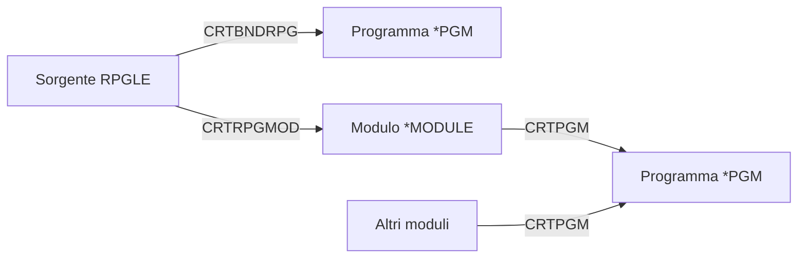

Prima di scrivere il primo programma conviene capire dove vive: IBM i non organizza le cose
come Linux o Windows, e qualche concetto va imparato da zero.

## Tutto è un oggetto

Su IBM i ogni cosa è un **oggetto** con un nome, un tipo e una libreria: un programma è un
oggetto di tipo `*PGM`, un file di database è un `*FILE`, una coda di stampa è un `*OUTQ`.
Il sistema controlla che ogni oggetto si usi solo nel modo previsto dal suo tipo: un
programma, per esempio, non si può aprire e modificare come un file.

| Tipo | Che cos'è |
| ---- | --------- |
| `*LIB` | una libreria, che contiene altri oggetti |
| `*FILE` | un file: tabella di database, file sorgente, video, stampa |
| `*PGM` | un programma eseguibile |
| `*MODULE` | un modulo compilato, da collegare in un programma |
| `*SRVPGM` | un programma di servizio, una libreria di procedure condivise |
| `*DTAARA` | un'area dati, un piccolo valore condiviso tra programmi |

## Librerie e lista librerie

Una **libreria** contiene oggetti, ma non altre librerie: la struttura ha un solo livello
(tutte le librerie stanno nella libreria di sistema `QSYS`). Un oggetto si indica con
`LIBRERIA/OGGETTO`, per esempio `MIALIB/CLIENTI`.

Quando un programma usa un oggetto senza indicare la libreria, il sistema lo cerca nella
**lista librerie** del lavoro, `*LIBL`, nell'ordine in cui le librerie compaiono. È come il
`PATH` di una shell: la stessa applicazione può lavorare sui dati di prova o su quelli di
produzione cambiando solo la lista librerie.

```text title="Comandi per la lista librerie"
DSPLIBL
ADDLIBLE LIB(MIALIB)
CHGCURLIB CURLIB(MIALIB)
```

`DSPLIBL` mostra la lista librerie del lavoro, `ADDLIBLE` aggiunge `MIALIB` in cima alla parte
utente della lista, `CHGCURLIB` rende `MIALIB` la libreria corrente, quella in cui finiscono
gli oggetti creati senza indicare una libreria.

<Callout type="tip" title="Leggere i comandi CL">
  I comandi di IBM i sono abbreviazioni di un verbo e di un oggetto: `DSP` (display) `LIBL`
  (library list), `CRT` (create), `WRK` (work with), `CHG` (change), `DLT` (delete). Scrivi un
  comando e premi <kbd>F4</kbd>: il sistema mostra i suoi parametri da compilare.
</Callout>

## Dove stanno i sorgenti

Tradizionalmente un sorgente RPG è un **membro** di un **file sorgente fisico**, per
convenzione chiamato `QRPGLESRC`. Il file è come una cartella, i membri sono i sorgenti, e
ogni membro ha un **tipo** che dice all'editor e al compilatore che cosa contiene:

| Tipo del membro | Contenuto |
| --------------- | --------- |
| `RPGLE` | un sorgente ILE RPG |
| `SQLRPGLE` | un sorgente ILE RPG con istruzioni SQL embedded |
| `PF`, `LF` | la descrizione DDS di un file fisico o logico |
| `CLLE` | un programma in CL, il linguaggio di controllo |

```text title="Creare un file sorgente"
CRTSRCPF FILE(MIALIB/QRPGLESRC) RCDLEN(112)
```

La lunghezza di 112 caratteri lascia 100 colonne al codice: le prime 12 servono al numero di
sequenza e alla data di modifica di ogni riga.

I sorgenti possono anche stare nell'**IFS**, il file system di IBM i con le cartelle e i
percorsi che conosci (`/home/utente/src/ciao.rpgle`). È la scelta di chi usa Git, perché i
file dell'IFS sono normali file di testo. Code for IBM i lavora con entrambi.

## Dal sorgente al programma

Un sorgente RPG diventa un programma in due modi.

<Diagram alt="Due percorsi di compilazione: il sorgente RPGLE diventa un programma *PGM direttamente con CRTBNDRPG, oppure diventa un *MODULE con CRTRPGMOD e poi un *PGM con CRTPGM, che può collegare più moduli" caption="I comandi di compilazione">

</Diagram>

- `CRTBNDRPG` (create bound RPG program) compila e crea il programma in un passo solo. È il
  comando di tutti i giorni.
- `CRTRPGMOD` crea un modulo, e `CRTPGM` collega uno o più moduli in un programma. Serve
  quando un programma è fatto di più sorgenti, come vedrai nel modulo sulle procedure.
- Per un sorgente `SQLRPGLE` il comando è `CRTSQLRPGI`, che prima traduce le istruzioni SQL
  e poi chiama il compilatore RPG.

```text title="Compilare ed eseguire"
CRTBNDRPG PGM(MIALIB/CIAO) SRCFILE(MIALIB/QRPGLESRC) SRCMBR(CIAO)
CRTBNDRPG PGM(MIALIB/CIAO) SRCSTMF('/home/utente/src/ciao.rpgle')
CALL PGM(MIALIB/CIAO)
```

La prima riga compila un membro, la seconda un file dell'IFS. `CALL` esegue il programma.

## Quando qualcosa va storto

Il compilatore scrive il **listato di compilazione** in un file di spool, la coda delle
stampe del tuo utente: `WRKSPLF` lo mostra, e in fondo al listato ci sono gli errori con il
loro codice (per esempio `RNF7030`, un nome non dichiarato). Code for IBM i legge lo stesso
listato e mostra gli errori direttamente sulle righe del sorgente.

Quando invece un programma si ferma durante l'esecuzione, la storia è nel **registro del
lavoro**: `DSPJOBLOG` mostra i messaggi del tuo lavoro, e <kbd>F1</kbd> su un messaggio ne
spiega la causa.

<Callout type="try">
  1. Crea il file sorgente: `CRTSRCPF FILE(MIALIB/QRPGLESRC) RCDLEN(112)`.
  2. Elenca gli oggetti della tua libreria con `WRKOBJ OBJ(MIALIB/*ALL)`: dovresti vedere
     `QRPGLESRC`, di tipo `*FILE`.
  3. In Code for IBM i apri la vista dei sorgenti e trova il file appena creato: nella
     prossima lezione ci scriverai il primo programma.
</Callout>

## Verifica

<Quiz id="quiz-ambiente-ibm-i" title="L'ambiente IBM i" attempts={3}>
  <Question id="libreria-con-librerie" type="true-false" answer={false} objectives={["oggetti-e-librerie"]} explanation="Le librerie hanno un solo livello: tutte stanno in `QSYS`, e nessuna ne contiene altre.">
    Una libreria può contenere altre librerie, come una cartella contiene sottocartelle.
  </Question>

  <Question id="ricerca-oggetto" type="single" objectives={["oggetti-e-librerie"]} explanation="Senza libreria esplicita il sistema cerca l'oggetto nella lista librerie del lavoro, `*LIBL`, nell'ordine delle librerie.">
    Un programma apre il file `CLIENTI` senza indicare la libreria. Dove lo cerca il sistema?

    <Option correct>Nelle librerie della lista librerie del lavoro, nell'ordine</Option>
    <Option explanation="`QSYS` contiene le librerie, non i file delle applicazioni.">Solo nella libreria `QSYS`</Option>
    <Option explanation="Il sistema non guarda la libreria del programma, ma la lista librerie.">Nella libreria che contiene il programma</Option>
  </Question>

  <Question id="tipo-membro-sql" type="single" objectives={["compilare-ed-eseguire"]} explanation="Un sorgente con SQL embedded ha il tipo `SQLRPGLE` e si compila con `CRTSQLRPGI`.">
    Che tipo deve avere un membro sorgente RPG che contiene istruzioni SQL?

    <Option correct>`SQLRPGLE`</Option>
    <Option>`RPGLE`</Option>
    <Option>`SQL`</Option>
  </Question>

  <Question id="comando-compilazione" type="fill" objectives={["compilare-ed-eseguire"]} explanation="`CRTBNDRPG` crea il programma in un passo; `CALL` lo esegue.">
    Completa i comandi per compilare il membro `CIAO` in un programma ed eseguirlo.

    ```text
    <Blank answer="CRTBNDRPG" ignoreCase label="comando di compilazione" /> PGM(MIALIB/CIAO) SRCFILE(MIALIB/QRPGLESRC) SRCMBR(CIAO)
    <Blank answer="CALL" ignoreCase label="comando di esecuzione" /> PGM(MIALIB/CIAO)
    ```
  </Question>

  <Question id="dove-errori" type="single" objectives={["compilare-ed-eseguire"]} explanation="Il listato di compilazione è un file di spool: si trova con `WRKSPLF`.">
    La compilazione fallisce. Dove trovi l'elenco degli errori, se non usi un editor che li
    mostra?

    <Option correct>Nel listato di compilazione, con `WRKSPLF`</Option>
    <Option explanation="`DSPJOBLOG` mostra i messaggi del lavoro, non gli errori riga per riga del sorgente.">Nel registro del lavoro, con `DSPJOBLOG`</Option>
    <Option>Nel membro sorgente, in fondo al codice</Option>
  </Question>
</Quiz>

## Come ti senti?

<Checkpoint id="checkpoint-introduzione">
  <Objective id="storia-rpg" review="./02-storia-di-rpg.mdx">
    Collocare RPG IV e il formato libero nella storia di RPG
  </Objective>
  <Objective id="oggetti-e-librerie" review="#librerie-e-lista-librerie">
    Descrivere oggetti, librerie e lista librerie di IBM i
  </Objective>
  <Objective id="compilare-ed-eseguire" review="#dal-sorgente-al-programma">
    Compilare un sorgente RPG ed eseguire il programma
  </Objective>
</Checkpoint>
