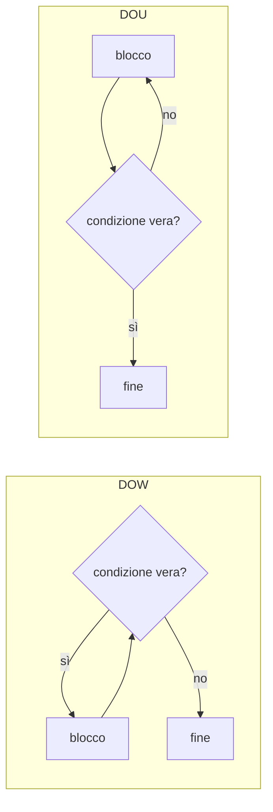

RPG ha le strutture di controllo dei linguaggi che conosci, con una particolarità: ogni
blocco si chiude con la sua parola, `endif`, `endsl`, `enddo` o `endfor`, invece che con una
graffa.

## IF

```text
if importo > 1000;
  sconto = 10;
elseif importo > 500;
  sconto = 5;
else;
  sconto = 0;
endif;
```

Le condizioni si combinano con `and`, `or` e `not`, e un indicatore è già una condizione:

```text
if trovato and not bloccato;
  dsply 'Cliente attivo';
endif;
```

## SELECT

Quando le alternative sono molte, `select` è più leggibile di una catena di `elseif`.
Vengono valutate in ordine le condizioni dei `when`: si esegue il primo blocco la cui
condizione è vera, e `other` raccoglie tutti gli altri casi.

```text
select;
  when stato = 'A';
    descrizione = 'Attivo';
  when stato = 'S' or stato = 'X';
    descrizione = 'Sospeso';
  other;
    descrizione = 'Sconosciuto';
endsl;
```

A differenza dello `switch` di altri linguaggi, ogni `when` ha una condizione completa, e
dopo il primo `when` vero l'esecuzione esce dalla `select`: non serve un `break`.

## I cicli

RPG ha tre cicli: `dow` (*do while*), `dou` (*do until*) e `for`.

```text
dow saldo > 0;          // ripete finché la condizione è vera
  saldo -= rata;
  mesi += 1;
enddo;

dou risposta = 'S' or risposta = 'N';   // ripete finché la condizione diventa vera
  dsply 'Confermi (S/N)?' '' risposta;
enddo;

for i = 1 to 10;        // da 1 a 10 compresi
  totale += i;
endfor;

for i = 10 downto 1 by 2;   // 10, 8, 6, 4, 2
  dsply %char(i);
endfor;
```

La differenza tra `dow` e `dou` è **quando** si controlla la condizione:

<Diagram alt="DOW controlla la condizione prima di ogni giro e può non eseguire mai il blocco; DOU esegue il blocco e controlla la condizione dopo, quindi lo esegue almeno una volta" caption="DOW e DOU">

</Diagram>

- `dow` controlla **prima** di ogni giro: se la condizione è falsa all'inizio, il blocco non si
  esegue mai.
- `dou` controlla **dopo** ogni giro: il blocco si esegue sempre almeno una volta, e il ciclo
  finisce quando la condizione diventa vera.
- `for` conta: dichiara la variabile del contatore (un intero) prima del ciclo.

<Callout type="note" title="dsply con risposta">
  Nell'esempio di `dou`, `dsply` ha tre operandi: il messaggio, la coda dei messaggi (vuota,
  cioè il terminale) e la variabile che riceve quello che scrive l'utente.
</Callout>

## LEAVE e ITER

Dentro un ciclo, `leave` esce subito dal ciclo e `iter` salta al giro successivo:

```text
for i = 1 to %elem(codici);
  if codici(i) = *blanks;
    iter;               // salta le posizioni vuote
  endif;
  if codici(i) = cercato;
    posizione = i;
    leave;              // trovato: smetti di cercare
  endif;
endfor;
```

`codici(i)` è l'elemento `i` di un array: li vedrai nel prossimo modulo.

<Callout type="try">
  1. Scrivi un programma che calcola in quanti mesi si estingue un debito di 1000 euro con una
     rata di 75 euro al mese, con `dow`.
  2. Riscrivi il ciclo con `dou` e controlla che il risultato sia lo stesso.
  3. Cosa succede con un debito di 0 euro nei due casi?
</Callout>

## Verifica

<Quiz id="quiz-controllo-del-flusso" title="Condizioni e cicli" attempts={3}>
  <Question id="dou-almeno-una-volta" type="single" objectives={["controllo-del-flusso-rpg"]} explanation="`dou` controlla la condizione alla fine di ogni giro, quindi il blocco si esegue almeno una volta.">
    Quale ciclo esegue il suo blocco **almeno una volta**, anche se la condizione è già
    soddisfatta all'inizio?

    <Option correct>`dou`</Option>
    <Option explanation="`dow` controlla la condizione prima del primo giro.">`dow`</Option>
    <Option explanation="Un `for` da 1 a 0 non esegue mai il blocco.">`for`</Option>
  </Question>

  <Question id="chiusure-blocchi" type="fill" objectives={["controllo-del-flusso-rpg"]} explanation="Ogni struttura ha la sua chiusura: `endsl` per `select`, `enddo` per `dow` e `dou`, `endfor` per `for`.">
    Completa le chiusure dei blocchi.

    ```text
    select;
      when stato = 'A';
        attivi += 1;
      other;
        altri += 1;
    <Blank answer="endsl" ignoreCase label="chiusura di select" />;

    dow saldo > 0;
      saldo -= rata;
    <Blank answer="enddo" ignoreCase label="chiusura di dow" />;
    ```
  </Question>

  <Question id="giri-del-for" type="fill" objectives={["controllo-del-flusso-rpg"]} explanation="Il contatore vale 10, 8, 6, 4 e 2: cinque giri.">
    Quante volte si esegue il blocco di `for i = 10 downto 1 by 2`? <Blank answer={5} label="numero di giri" />
  </Question>

  <Question id="select-primo-when" type="true-false" answer={true} objectives={["controllo-del-flusso-rpg"]} explanation="La `select` esegue solo il primo `when` vero e poi esce, senza bisogno di `break`.">
    Se più `when` di una `select` sono veri, si esegue solo il primo.
  </Question>

  <Question id="ciclo-infinito" type="find-error" objectives={["controllo-del-flusso-rpg"]} explanation="Il ciclo controlla `saldo`, ma il blocco non lo cambia mai: alla riga 6 bisogna togliere la rata da `saldo` (`saldo -= 75;`), non assegnare il risultato a `residuo`.">
    Questo ciclo non finisce mai. Quale riga contiene l'errore?

    ```text showLineNumbers error={6}
    dcl-s saldo packed(9:2) inz(1000);
    dcl-s residuo packed(9:2);
    dcl-s mesi int(10);

    dow saldo > 0;
      residuo = saldo - 75;
      mesi += 1;
    enddo;
    ```
  </Question>
</Quiz>

## Come ti senti?

Prima di passare alle strutture dati, indica quanto ti senti sicuro sugli obiettivi del
modulo. Quelli da rivedere ti riportano alla lezione giusta.

<Checkpoint id="checkpoint-basi-del-linguaggio">
  <Objective id="primo-programma-rpg" review="./01-primo-programma.mdx">
    Scrivere, compilare ed eseguire un programma in formato libero
  </Objective>
  <Objective id="dichiarazioni-e-tipi" review="./02-tipi-di-dati.mdx">
    Dichiarare variabili e costanti scegliendo il tipo di dati adatto
  </Objective>
  <Objective id="espressioni-e-funzioni" review="./03-espressioni-e-bif.mdx">
    Scrivere espressioni con le funzioni incorporate
  </Objective>
  <Objective id="controllo-del-flusso-rpg" review="#i-cicli">
    Controllare il flusso con condizioni e cicli
  </Objective>
</Checkpoint>
