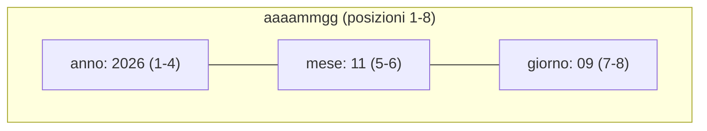

Una **struttura dati** (in inglese *data structure*, spesso DS) raggruppa più campi, i
**sottocampi**, in un'unica area di memoria. Serve a tenere insieme i dati di una stessa
cosa, come un cliente, ma anche a guardare la stessa area di memoria in modi diversi: è uno
degli strumenti più usati di RPG.

## Dichiarare una struttura

```text
dcl-ds cliente qualified inz;
  codice char(6);
  ragioneSociale varchar(50);
  citta char(30);
  saldo packed(11:2);
end-ds;

cliente.codice = 'C00042';
cliente.saldo += 150.00;
```

- `dcl-ds` apre la struttura e `end-ds` la chiude; in mezzo ci sono i sottocampi, dichiarati
  come le variabili ma senza `dcl-s`.
- `qualified` obbliga a scrivere il nome della struttura davanti a ogni sottocampo,
  `cliente.codice`. Senza, il sottocampo si chiama solo `codice`, come una variabile
  globale: è il comportamento storico, ma rende il codice più difficile da leggere.
- `inz` inizializza ogni sottocampo al valore predefinito del suo tipo: spazi per i testi,
  zero per i numeri.

<Callout type="danger" title="Errore sui dati decimali">
  Senza `inz`, una struttura dati parte **tutta piena di spazi**, anche nei sottocampi
  numerici. Un campo `packed` pieno di spazi non contiene un numero valido, e il primo
  calcolo che lo usa ferma il programma con lo stato `00907`, *decimal data error*. È uno
  degli errori più comuni in RPG: metti sempre `inz` sulle strutture con sottocampi numerici.
</Callout>

## Pulire e ripristinare

```text
clear cliente;    // spazi nei testi, zero nei numeri
reset cliente;    // torna ai valori iniziali di inz
```

`clear` e `reset` funzionano su una struttura intera, su un sottocampo o su una variabile.
La differenza si vede quando un sottocampo ha un valore iniziale suo, come
`citta char(30) inz('Torino')`: `clear` lo svuota, `reset` lo riporta a `Torino`.

## Modelli e LIKEDS

Spesso servono più strutture uguali: l'indirizzo di fatturazione e quello di spedizione, il
cliente letto e quello da salvare. Un **modello** (`template`) descrive la forma senza
occupare memoria, e `likeds` dichiara strutture con quella forma:

```text
dcl-ds indirizzo_t qualified template;
  via varchar(50);
  cap char(5);
  citta varchar(30);
  provincia char(2);
end-ds;

dcl-ds fatturazione likeds(indirizzo_t) inz;
dcl-ds spedizione likeds(indirizzo_t) inz;

spedizione = fatturazione;
spedizione.citta = 'Milano';
```

Il suffisso `_t` per i modelli è una convenzione diffusa, non un obbligo. Una struttura
dichiarata con `likeds` è sempre qualificata. Una struttura si può assegnare a un'altra in un
colpo solo, come in `spedizione = fatturazione`.

Una struttura può anche contenerne un'altra, con un sottocampo dichiarato con `likeds`:

```text
dcl-ds ordine qualified inz;
  numero int(10);
  data date;
  destinazione likeds(indirizzo_t);
end-ds;

ordine.destinazione.cap = '10121';
```

## Sottocampi sovrapposti

I sottocampi di una struttura occupano posizioni consecutive nella sua area di memoria. Con
`pos` si sceglie la posizione di un sottocampo, e con `overlay` lo si sovrappone a un altro:
così la stessa memoria si legge in modi diversi.

```text showLineNumbers
dcl-ds dataTesto;
  aaaammgg char(8);
  anno char(4) overlay(aaaammgg);
  mese char(2) overlay(aaaammgg : 5);
  giorno char(2) overlay(aaaammgg : 7);
end-ds;

aaaammgg = '20261109';
// anno = '2026', mese = '11', giorno = '09'
```

`anno` comincia dove comincia `aaaammgg`, `mese` dalla quinta posizione, `giorno` dalla
settima. Cambiando `aaaammgg` cambiano anche gli altri, perché sono la stessa memoria.

<Diagram alt="Gli 8 caratteri di aaaammgg, da 2026 1109: le posizioni da 1 a 4 sono anche anno, le 5 e 6 mese, le 7 e 8 giorno" caption="Una sola area di memoria, quattro nomi">

</Diagram>

Questa tecnica è ovunque nel codice storico, per esempio per spezzare un codice articolo
nelle sue parti. Per le date, oggi, è meglio un campo `date`, con le funzioni che hai visto
nel modulo precedente.

<Callout type="try">
  1. Dichiara una struttura `articolo` con un codice `char(10)` e tre sottocampi sovrapposti:
     la famiglia (2 caratteri), il modello (5) e la variante (3).
  2. Assegna `'TV55OLEDNR'` al codice e mostra con `dsply` le tre parti.
  3. Togli `inz` da una struttura con un sottocampo `packed`, usalo in un calcolo e leggi
     l'errore.
</Callout>

## Verifica

<Quiz id="quiz-strutture-dati" title="Le strutture dati" attempts={3}>
  <Question id="ds-senza-inz" type="single" objectives={["strutture-dati-rpg"]} explanation="Senza `inz` la struttura è piena di spazi, che non sono un valore `packed` valido: il calcolo fallisce con lo stato `00907`.">
    Una struttura senza `inz` ha un sottocampo `totale packed(9:2)`. Che cosa succede alla
    prima istruzione `ds.totale += 1;`?

    <Option correct>Il programma si ferma con un errore sui dati decimali</Option>
    <Option explanation="Una struttura senza `inz` non contiene zeri, ma spazi.">`totale` vale 1</Option>
    <Option explanation="Non è un errore di compilazione: il problema c'è solo durante l'esecuzione.">Il programma non si compila</Option>
  </Question>

  <Question id="template-memoria" type="true-false" answer={false} objectives={["strutture-dati-rpg"]} explanation="Un modello descrive solo la forma: non occupa memoria e non si può usare per contenere dati.">
    Una struttura dichiarata con `template` si può usare per contenere dei dati, come le altre.
  </Question>

  <Question id="overlay-mese" type="fill" objectives={["strutture-dati-rpg"]} explanation="`mese` comincia dalla quinta posizione di `aaaammgg` ed è lungo 2: con `20261109` vale `11`.">
    Con la struttura `dataTesto` della lezione e `aaaammgg = '20261109'`, `giorno` vale
    <Blank answer="09" label="valore di giorno" /> e `mese` vale <Blank answer="11" label="valore di mese" />.
  </Question>

  <Question id="clear-reset" type="single" objectives={["strutture-dati-rpg"]} explanation="`reset` riporta ai valori iniziali di `inz`; `clear` mette spazi e zeri.">
    Un sottocampo è dichiarato `citta char(30) inz('Torino')`. Quale istruzione lo riporta a
    `Torino`?

    <Option correct>`reset`</Option>
    <Option explanation="`clear` lo riempie di spazi.">`clear`</Option>
    <Option>`citta = *blanks`</Option>
  </Question>

  <Question id="ds-qualificata" type="find-error" objectives={["strutture-dati-rpg"]} explanation="La struttura è `qualified`: il sottocampo va scritto `cliente.saldo`.">
    Questo codice non si compila. Quale riga contiene l'errore?

    ```text showLineNumbers error={7}
    dcl-ds cliente qualified inz;
      codice char(6);
      saldo packed(11:2);
    end-ds;

    cliente.codice = 'C00042';
    saldo = 100;
    ```
  </Question>
</Quiz>
