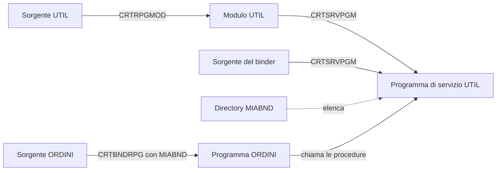

Una procedura utile prima o poi serve a più programmi: formattare un importo, calcolare una
scadenza, controllare una partita IVA. Copiarla in ogni sorgente vuol dire correggere ogni
copia a ogni modifica. ILE risolve il problema con i **programmi di servizio**: oggetti di
tipo `*SRVPGM` che contengono procedure da usare in molti programmi.

## I pezzi

<Diagram alt="Il sorgente UTIL diventa il modulo UTIL con CRTRPGMOD; il modulo e il sorgente del binder diventano il programma di servizio UTIL con CRTSRVPGM; la directory di collegamento MIABND elenca UTIL; il programma ORDINI, compilato con CRTBNDRPG e la directory MIABND, si collega a UTIL e ne chiama le procedure" caption="Dal sorgente al programma di servizio">

</Diagram>

1. Un **membro dei prototipi**, che ogni programma include.
2. Un **modulo** con le procedure, senza codice principale.
3. Un **sorgente del binder**, che elenca le procedure esportate.
4. Il **programma di servizio**, creato dal modulo e dal sorgente del binder.
5. Una **directory di collegamento**, che dice al compilatore dove cercare le procedure.

## I prototipi, in un posto solo

I prototipi delle procedure stanno in un membro a parte, che il modulo e i programmi
includono con `/copy`. Così chi chiama e chi è chiamato usano la stessa definizione, e il
compilatore controlla ogni chiamata.

```text title="QRPGLESRC, membro UTILPR"
**FREE
dcl-pr formattaImporto varchar(25);
  importo packed(15:2) const;
end-pr;

dcl-pr maiuscolo varchar(256);
  testo varchar(256) const;
end-pr;
```

## Il modulo

```text title="QRPGLESRC, membro UTIL" showLineNumbers {2,4,9,17}
**FREE
ctl-opt nomain decedit(',');

/copy QRPGLESRC,UTILPR

dcl-c MINUSCOLE 'abcdefghijklmnopqrstuvwxyz';
dcl-c MAIUSCOLE 'ABCDEFGHIJKLMNOPQRSTUVWXYZ';

dcl-proc formattaImporto export;
  dcl-pi *n varchar(25);
    importo packed(15:2) const;
  end-pi;

  return %trim(%editc(importo : 'J'));
end-proc;

dcl-proc maiuscolo export;
  dcl-pi *n varchar(256);
    testo varchar(256) const;
  end-pi;

  return %xlate(MINUSCOLE : MAIUSCOLE : testo);
end-proc;
```

- `nomain` dice che il modulo non ha codice principale: contiene solo procedure, e non può
  diventare un programma da solo.
- `decedit(',')` usa la virgola come separatore decimale e il punto per le migliaia negli
  importi formattati: `1234567.5` diventa `1.234.567,50`.
- `/copy` include il membro dei prototipi, che deve corrispondere alle interfacce.
- `export` rende la procedura visibile fuori dal modulo. Una procedura senza `export` resta
  privata del modulo.

## Il sorgente del binder

Il sorgente del binder, un membro di tipo `BND` (per convenzione nel file `QSRVSRC`), elenca
le procedure che il programma di servizio esporta e dà all'elenco una **firma**:

```text title="QSRVSRC, membro UTIL"
STRPGMEXP PGMLVL(*CURRENT) SIGNATURE('UTIL V1')
  EXPORT SYMBOL(FORMATTAIMPORTO)
  EXPORT SYMBOL(MAIUSCOLO)
ENDPGMEXP
```

I nomi sono in maiuscolo perché RPG esporta così i nomi delle procedure.

Un programma collegato al programma di servizio ne ricorda la firma e la posizione di ogni
procedura nell'elenco. Per questo le regole sono due:

- aggiungi le procedure nuove **in fondo** all'elenco, tenendo la stessa firma: i programmi
  già compilati continuano a funzionare senza essere ricompilati;
- non togliere e non riordinare mai le righe `EXPORT`: i programmi esistenti chiamerebbero
  la procedura sbagliata, o non partirebbero più.

## Creare gli oggetti

```text title="Comandi"
CRTRPGMOD MODULE(MIALIB/UTIL) SRCFILE(MIALIB/QRPGLESRC) SRCMBR(UTIL)
CRTSRVPGM SRVPGM(MIALIB/UTIL) MODULE(MIALIB/UTIL) EXPORT(*SRCFILE) SRCFILE(MIALIB/QSRVSRC) SRCMBR(UTIL)
CRTBNDDIR BNDDIR(MIALIB/MIABND)
ADDBNDDIRE BNDDIR(MIALIB/MIABND) OBJ((MIALIB/UTIL *SRVPGM))
```

Le prime due righe vanno ripetute a ogni modifica del modulo; la directory di collegamento si
crea una volta sola, e si aggiorna quando aggiungi un altro programma di servizio.

## Usare il programma di servizio

```text title="QRPGLESRC, membro ORDINI" showLineNumbers {2,4}
**FREE
ctl-opt dftactgrp(*no) actgrp(*new) bnddir('MIABND');

/copy QRPGLESRC,UTILPR

dcl-s messaggio varchar(52);

messaggio = maiuscolo('Totale: ') + formattaImporto(1234567.5);
dsply messaggio;

*inlr = *on;
return;
```

`bnddir('MIABND')` dice a `CRTBNDRPG` dove cercare le procedure che il programma non
contiene. Il programma si compila come sempre:

```text
CRTBNDRPG PGM(MIALIB/ORDINI) SRCFILE(MIALIB/QRPGLESRC) SRCMBR(ORDINI)
CALL PGM(MIALIB/ORDINI)
```

Il codice delle procedure **non** viene copiato in `ORDINI`: il programma si collega a `UTIL`
quando parte. Se correggi un errore in `formattaImporto` e ricrei `UTIL`, tutti i programmi
che lo usano vedono la correzione, senza essere ricompilati.

<Callout type="note" title="Collegamento per copia">
  Un modulo si può anche collegare direttamente in un programma, con
  `CRTPGM PGM(MIALIB/ORDINI) MODULE(MIALIB/ORDINI MIALIB/UTIL)`. In questo caso il codice di
  `UTIL` viene copiato in `ORDINI`, e una correzione richiede di ricreare ogni programma.
  Per il codice condiviso si preferiscono i programmi di servizio.
</Callout>

<Callout type="try">
  1. Crea i membri `UTILPR`, `UTIL` e il sorgente del binder, poi il programma di servizio e
     la directory di collegamento.
  2. Compila ed esegui `ORDINI`.
  3. Aggiungi a `UTIL` una procedura esportata `minuscolo`, in fondo al sorgente del binder.
     Ricrea `UTIL` senza ricompilare `ORDINI` ed esegui di nuovo `ORDINI`: funziona ancora?
</Callout>

## Verifica

<Quiz id="quiz-programmi-di-servizio" title="Moduli e programmi di servizio" attempts={3}>
  <Question id="ordine-creazione" type="order" objectives={["programmi-di-servizio-rpg"]} explanation="Si compila il modulo, si crea il programma di servizio, lo si elenca nella directory di collegamento e infine si compila il programma che lo usa.">
    Metti in ordine i passi per usare una procedura di un programma di servizio nuovo.

    <Option>Creare il modulo con `CRTRPGMOD`</Option>
    <Option>Creare il programma di servizio con `CRTSRVPGM`</Option>
    <Option>Aggiungere il programma di servizio alla directory di collegamento</Option>
    <Option>Compilare il programma che la chiama con `CRTBNDRPG`</Option>
  </Question>

  <Question id="parola-export" type="single" objectives={["programmi-di-servizio-rpg"]} explanation="Senza `export` la procedura è visibile solo dentro il suo modulo.">
    Che cosa rende una procedura chiamabile da un altro modulo o programma?

    <Option correct>La parola chiave `export` su `dcl-proc`</Option>
    <Option explanation="`nomain` dice solo che il modulo non ha codice principale.">L'opzione `nomain` in `ctl-opt`</Option>
    <Option explanation="Il prototipo descrive la chiamata, ma non rende visibile la procedura.">Il prototipo nel membro `/copy`</Option>
  </Question>

  <Question id="nuova-procedura-binder" type="single" objectives={["programmi-di-servizio-rpg"]} explanation="I programmi già compilati ricordano la posizione di ogni procedura: le nuove vanno in fondo, con la stessa firma.">
    Aggiungi una procedura a un programma di servizio usato da cento programmi. Dove la
    scrivi nel sorgente del binder?

    <Option correct>In fondo all'elenco degli `EXPORT`, mantenendo la firma</Option>
    <Option explanation="Riordinare l'elenco cambia la posizione delle procedure esistenti.">In ordine alfabetico, tra le altre</Option>
    <Option explanation="Non serve un altro programma di servizio per una procedura in più.">In un nuovo sorgente del binder</Option>
  </Question>

  <Question id="correzione-senza-ricompilare" type="true-false" answer={true} objectives={["programmi-di-servizio-rpg"]} explanation="Il codice del programma di servizio non è copiato nei programmi: basta ricrearlo, se l'elenco delle procedure resta compatibile.">
    Se correggi una procedura di un programma di servizio e lo ricrei, i programmi che la
    usano vedono la correzione senza essere ricompilati.
  </Question>
</Quiz>
