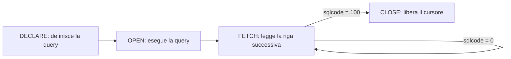

`select … into` legge una riga. Per scorrere il risultato di una query riga per riga serve un
**cursore**: un segnaposto sul risultato, che il programma apre, legge e chiude.

## Il ciclo di vita di un cursore

<Diagram alt="DECLARE definisce la query, OPEN la esegue, FETCH legge una riga alla volta finché sqlcode vale 100, CLOSE libera il cursore" caption="Le quattro istruzioni di un cursore">

</Diagram>

```text title="CLICITTA.SQLRPGLE" showLineNumbers
**FREE
ctl-opt dftactgrp(*no) actgrp(*new);

exec sql set option commit = *none, naming = *sys;

dcl-ds cliente qualified inz;
  codice char(6);
  nome char(40);
  saldo packed(11:2);
end-ds;
dcl-s citta char(30) inz('Torino');

exec sql
  declare clientiCitta cursor for
    select codice, nome, saldo
      from clienti
      where citta = :citta
      order by nome;

exec sql open clientiCitta;

exec sql fetch next from clientiCitta into :cliente;
dow sqlcode = 0;
  dsply (cliente.codice + ' ' + %trim(cliente.nome));
  exec sql fetch next from clientiCitta into :cliente;
enddo;

if sqlcode < 0;
  dsply ('Errore SQL ' + %char(sqlcode));
endif;

exec sql close clientiCitta;

*inlr = *on;
return;
```

- `declare` definisce la query, ma non la esegue. Va scritta **prima**, nel sorgente, delle
  istruzioni che usano il cursore.
- `open` esegue la query con i valori **attuali** delle variabili host: se `citta` cambia
  dopo l'`open`, il cursore non se ne accorge.
- `fetch next` legge la riga successiva. Le colonne vanno nei sottocampi di `cliente`, in
  ordine: una struttura dati come variabile host vale quanto l'elenco dei suoi sottocampi.
- Quando le righe finiscono, `fetch` imposta `sqlcode` a 100. È lo stesso schema del ciclo
  con `read`: la prima lettura prima del ciclo, la successiva in fondo.
- `close` libera il cursore. Un cursore aperto non si può riaprire: se il programma passa
  di nuovo da `open` senza averlo chiuso, `open` fallisce.

## Più righe alla volta

Ogni `fetch` è una richiesta al database. Con molte righe conviene leggerne un blocco alla
volta in un **array di strutture dati**:

```text title="Lettura a blocchi" showLineNumbers
dcl-ds blocco qualified dim(100) inz;
  codice char(6);
  nome char(40);
  saldo packed(11:2);
end-ds;
dcl-s lette int(10);
dcl-s i int(10);
dcl-s totale packed(15:2);

exec sql open clientiCitta;

dou lette < 100;
  exec sql fetch next from clientiCitta for 100 rows into :blocco;
  if sqlcode < 0;
    leave;
  endif;
  lette = sqlerrd(3);
  for i = 1 to lette;
    totale += blocco(i).saldo;
  endfor;
enddo;

exec sql close clientiCitta;
```

- `for 100 rows` legge fino a 100 righe in una volta nell'array `blocco`, che ha 100
  elementi.
- `sqlerrd(3)` dice quante righe sono arrivate davvero. Quando sono meno di 100, le righe sono
  finite e il ciclo `dou` si ferma.
- Il ciclo `for` interno usa `lette`, non `%elem(blocco)`: gli elementi dopo `lette`
  contengono ancora i valori del blocco precedente.

## Quando usare l'SQL e quando le istruzioni native

| Situazione | Scelta tipica |
| ---------- | ------------- |
| leggere o aggiornare **un** record di cui conosci la chiave | istruzioni native o SQL, a parità |
| aggiornare **molte** righe con la stessa regola | SQL, con un solo `UPDATE` |
| unire più tabelle, raggruppare, sommare, ordinare in modi diversi | SQL |
| leggere un file nell'ordine di una chiave, con la logica in RPG | istruzioni native o un cursore |
| mantenere un programma esistente scritto con le istruzioni native | le istruzioni native, per coerenza |

Nei programmi reali le due tecniche convivono spesso nello stesso sorgente: l'importante è
che ogni parte sia chiara per chi la legge dopo di te.

<Callout type="try">
  1. Compila `CLICITTA` e provalo con una città che ha dei clienti e con una che non ne ha.
  2. Aggiungi alla query il totale degli ordini di ogni cliente, con una `join` e un
     `group by` sul file `ORDINI`.
  3. Togli `exec sql close clientiCitta;` e fai chiamare la parte del cursore due volte dallo
     stesso programma: leggi l'errore dell'`open`.
</Callout>

## Verifica

<Quiz id="quiz-cursori" title="I cursori" attempts={3}>
  <Question id="ordine-cursore" type="order" objectives={["cursori-rpg"]} explanation="Si dichiara il cursore, lo si apre, si leggono le righe con `fetch` e infine lo si chiude.">
    Metti in ordine le istruzioni per leggere il risultato di una query con un cursore.

    <Option>`declare … cursor for select …`</Option>
    <Option>`open`</Option>
    <Option>`fetch next … into …`</Option>
    <Option>`close`</Option>
  </Question>

  <Question id="fine-righe" type="fill" objectives={["cursori-rpg"]} explanation="Quando non ci sono più righe, `fetch` imposta `sqlcode` a 100.">
    Il ciclo di `fetch` continua finché `sqlcode` vale 0; quando le righe finiscono,
    `sqlcode` vale <Blank answer={100} label="sqlcode a fine righe" />.
  </Question>

  <Question id="variabili-dopo-open" type="true-false" answer={false} objectives={["cursori-rpg"]} explanation="La query usa i valori delle variabili host al momento dell'`open`; i cambiamenti successivi non contano finché il cursore non viene chiuso e riaperto.">
    Se dopo l'`open` cambi la variabile host usata nella `where`, il cursore restituisce le
    righe che corrispondono al nuovo valore.
  </Question>

  <Question id="righe-lette" type="single" objectives={["cursori-rpg"]} explanation="Dopo un `fetch` di più righe, `sqlerrd(3)` contiene il numero di righe lette.">
    Dopo `fetch next from c for 100 rows into :righe`, dove trovi il numero di righe lette?

    <Option correct>In `sqlerrd(3)`</Option>
    <Option explanation="`%elem` restituisce il numero di elementi dichiarati, 100, anche se le righe sono meno.">In `%elem(righe)`</Option>
    <Option explanation="`sqlcode` dice l'esito, non il numero di righe.">In `sqlcode`</Option>
  </Question>

  <Question id="fetch-fuori-ciclo" type="find-error" objectives={["cursori-rpg"]} explanation="Alla riga 4 il ciclo controlla `%eof`, che riguarda le istruzioni native: dopo un `fetch` si controlla `sqlcode`.">
    Questo ciclo non legge nessuna riga. Quale riga contiene l'errore?

    ```text showLineNumbers error={4}
    exec sql open clientiCitta;

    exec sql fetch next from clientiCitta into :cliente;
    dow %eof();
      dsply cliente.codice;
      exec sql fetch next from clientiCitta into :cliente;
    enddo;

    exec sql close clientiCitta;
    ```
  </Question>
</Quiz>

## Come ti senti?

<Checkpoint id="checkpoint-sql-embedded">
  <Objective id="sql-embedded-rpg" review="./01-sql-nei-programmi.mdx">
    Eseguire istruzioni SQL con variabili host e controllarne l'esito
  </Objective>
  <Objective id="cursori-rpg" review="#il-ciclo-di-vita-di-un-cursore">
    Leggere insiemi di righe con i cursori
  </Objective>
</Checkpoint>
