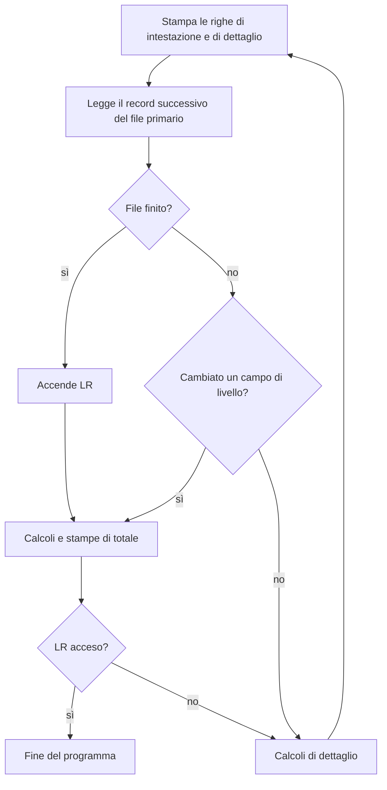

Due eredità del passato rendono il codice storico difficile da leggere: gli **indicatori**,
variabili booleane con un numero al posto del nome, e il **ciclo RPG**, un flusso del
programma che non si vede nel codice. Questa lezione li spiega entrambi.

## Gli indicatori

Un indicatore è una variabile di un carattere che vale `'1'` (acceso, `*on`) o `'0'` (spento,
`*off`). Ogni programma ne ha un gruppo predefinito, senza dichiararli:

| Indicatori | Uso |
| ---------- | --- |
| `*IN01`-`*IN99` | uso generale: il significato lo decide il programmatore |
| `*INLR` | ultimo record: acceso, termina il programma alla fine del ciclo |
| `*INKA`-`*INKY` | tasti funzione premuti in un video: `*INKC` è <kbd>F3</kbd>, `*INKL` è <kbd>F12</kbd> |
| `*INOF`, `*INOA`-`*INOG`, `*INOV` | fine pagina di una stampa |
| `*INL1`-`*INL9` | rottura di livello nel ciclo RPG |
| `*INH1`-`*INH9` | arresto del programma |

Nel codice storico gli indicatori numerati sono ovunque: indicatori risultanti delle
istruzioni, indicatori di condizione nelle colonne 9-11, campi dei video che si accendono e
spengono. Il problema è che `*IN43` non dice niente: per sapere che cosa significa bisogna
cercare **tutti** i punti che lo accendono o lo spengono.

In formato libero gli indicatori si usano come variabili:

```text
*in99 = *on;
if *in99;
  dsply 'Indicatore 99 acceso';
endif;
```

ma il codice nuovo dovrebbe sostituirli con variabili `ind` che hanno un nome:

```text
dcl-s clienteTrovato ind;

chain codcli clienti;
clienteTrovato = %found(clienti);
```

Per i video e le stampe, che comunicano con il programma proprio attraverso gli indicatori
numerati, la parola chiave `indds` di `dcl-f` collega gli indicatori del file a una struttura
dati, dove ognuno può avere un nome come `uscita` al posto di `*IN03`.

## Il ciclo RPG

RPG è nato per produrre stampe dai dati, e il suo flusso di base è sempre stato lo stesso:
leggi un record, fai i calcoli, stampa, ripeti. Questo ciclo è **implicito**: il compilatore
lo aggiunge a ogni programma, e un programma che dichiara un **file primario** non ha bisogno
di scrivere nessuna `read`.

<Diagram alt="Il ciclo RPG semplificato: scrive le righe di dettaglio, legge il record successivo del file primario; se il file è finito accende LR; se c'è una rottura di livello o LR è acceso esegue i calcoli e le stampe di totale; se LR è acceso termina; altrimenti esegue i calcoli di dettaglio e ricomincia" caption="Il ciclo RPG, in forma semplificata">

</Diagram>

Un programma che usa il ciclo si riconosce dalla specifica F: una `P` in colonna 18 indica il
file **primario**, che il ciclo legge da solo.

```text
     FCLIENTI   IP   E           K DISK
```

Con gli **indicatori di livello** (`L1`-`L9`) il programma dice quali campi raggruppano i
record: quando la città cambia, per esempio, si accende `L1` e il ciclo esegue i calcoli e le
stampe di totale della città precedente. Un report con subtotali per città si scriveva così
in poche righe, senza un solo ciclo nel codice.

Le dichiarazioni in formato libero non supportano i file primari: un programma con il ciclo si
modernizza di solito riscrivendo la lettura con un ciclo esplicito, `read` e `dow not %eof`,
e i totali con un confronto tra il valore del campo e quello del record precedente.

## Perché `*inlr = *on`

Anche un programma senza file primario passa dal ciclo: alla fine dei calcoli il ciclo
controlla `LR`, e se è spento ricomincia ed esegue di nuovo i calcoli. Per questo un
programma che usa il ciclo deve terminare in uno di questi modi:

| Fine del programma | Che cosa succede |
| ------------------ | ---------------- |
| `*inlr = *on` e fine dei calcoli | il ciclo vede `LR` acceso: chiude i file e libera la memoria |
| `*inlr = *on; return;` | come sopra, subito: è la forma più comune |
| `return` con `LR` spento | il programma termina, ma finché il suo gruppo di attivazione esiste resta attivo, con i file aperti e le variabili conservate per la chiamata successiva |
| né `LR` né `return` | il ciclo ricomincia ed esegue di nuovo i calcoli, all'infinito |

Il terzo caso era un modo di rendere più veloci le chiamate ripetute, e a volte lo troverai
usato apposta: un programma che «ricorda» i valori tra una chiamata e l'altra. Con
`ctl-opt main(...)`, come nella prima lezione del corso, il ciclo non c'è e niente di tutto
questo si applica.

<Callout type="try">
  1. In un programma di prova togli `*inlr = *on` e `return`, e aggiungi un `dsply` alla fine
     dei calcoli: quante volte compare il messaggio? Interrompi il programma con
     <kbd>Sys Req</kbd> e l'opzione 2.
  2. Riscrivi il programma con `ctl-opt main(...)` e una procedura principale.
</Callout>

## Ripasso finale

Ogni tentativo estrae cinque domande da tutto il corso, diverse a ogni tentativo finché ce ne
sono.

<Quiz id="quiz-ripasso-finale" title="Ripasso finale del corso" attempts={3}>
  <Draw bank="ripasso-finale" count={5} />
</Quiz>

## Come ti senti?

<Checkpoint id="checkpoint-codice-storico">
  <Objective id="formato-fisso-rpg" review="./01-formato-fisso.mdx">
    Leggere le specifiche a formato fisso e tradurle in formato libero
  </Objective>
  <Objective id="indicatori-e-ciclo-rpg" review="#il-ciclo-rpg">
    Riconoscere gli indicatori e il ciclo RPG nei programmi esistenti
  </Objective>
</Checkpoint>

## Dove andare adesso

Hai le basi per leggere e scrivere programmi RPG. Gli argomenti da affrontare dopo:

- i **video** (*display file*, `DSPF`) e i **subfile**, con cui si scrivono i programmi
  interattivi a schermo verde;
- le **stampe** (*printer file*, `PRTF`);
- i **test** automatici dei programmi RPG, per esempio con RPGUnit;
- la gestione dei sorgenti con **Git**, con i sorgenti nell'IFS.

La documentazione di riferimento è quella di IBM, nella sezione *Programming* della
[documentazione di IBM i](https://www.ibm.com/docs/en/i): il manuale *ILE RPG Reference*
descrive ogni istruzione, il *ILE RPG Programmer's Guide* spiega come compilare, collegare e
correggere i programmi.
